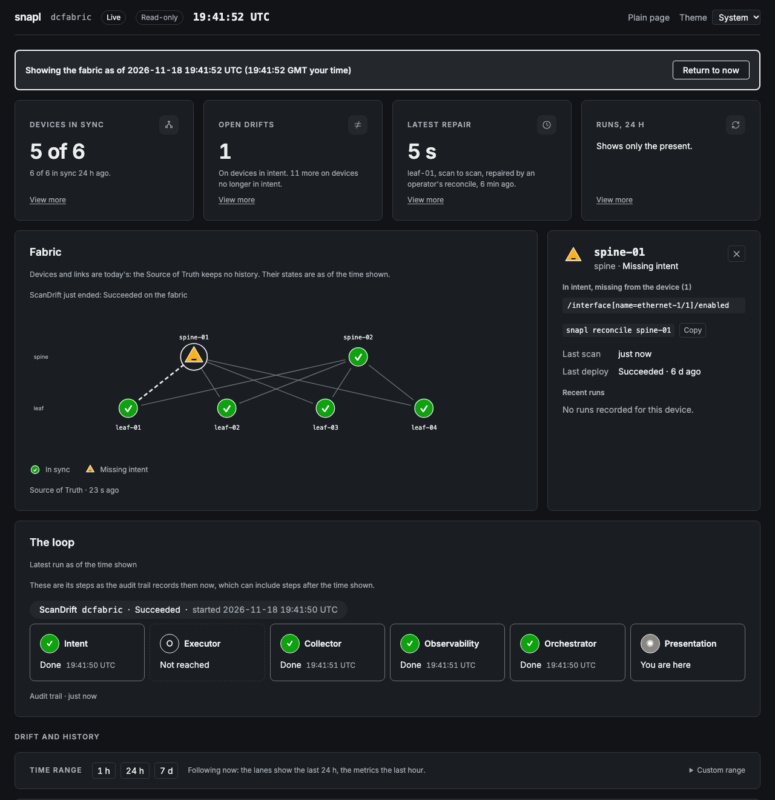

# snapl

A closed network automation loop (**intent → deploy → verify → drift → reconcile**) running against a real Nokia SR Linux fabric, built as the [Network Automation Forum (NAF)](https://networkautomation.forum/) Framework's six building blocks.

## What it does

The Source of Truth (Infrahub) holds what the network is supposed to look like. snapl renders that intent, pushes it to the devices over gNMI, reads the devices back, and compares the two.

When they disagree, that's drift. snapl reports it, and an operator can reconcile the device back to intent. Every step runs as a durable Temporal workflow and lands in an audit trail that survives restarts.

What this demonstrates, live, on a six-node spine-leaf fabric in Containerlab:

- **Deploy and verify.** `snapl deploy spine-01` renders intent, applies it, then collects the device's state and checks that the change actually took.
- **Drift detection in both directions.** `snapl scan` flags config the device is *missing* and config the device carries that intent *never asked for*: a hand-added interface address or BGP neighbour.
- **Reconcile.** `snapl reconcile` re-applies intent to drifted devices. Remediation is always operator-triggered, never automatic.
- **Health, separate from drift.** The worker streams each device's interfaces, BGP sessions, CPU and memory over gNMI every 10 s. It flags a device when an interface intent expects up is down, or a session intent expects is not established. A device can be in sync and still flagged: on the lab, a leaf's uplink disabled by hand shows the leaf drifted and unhealthy, and the spine at the other end in sync but unhealthy. The flag came up in 19 s and cleared 48 s after the reconcile.
- **Durability.** Workflows survive a worker restart. `snapl audit` reads the trail by workflow or by device.

## NAF building blocks

| Block | Package | What it does here |
|-------|---------|-------------------|
| Intent | `snapl-intent` | Infrahub schema, seed data, desired-state models |
| Executor | `snapl-executor` | Jinja2 rendering + gNMI apply and dry-run |
| Collector | `snapl-collector` | gNMI GET of live device state; gNMI sample subscriptions for telemetry |
| Observability | `snapl-observability` | Structural drift diff, drift events, the device health rule |
| Orchestrator | `snapl-orchestrator` | Temporal workflows: deploy, scan, reconcile; durable audit |
| Presentation | `snapl-presentation` | The `snapl` operator CLI |

## Scope

- **Datacenter fabric (current):** spine-leaf eBGP underlay, 2 spines and 4 leaves. All 16 session ends establish, and each device advertises its loopback and learns the others'.
- **Site edge (next, #117):** a manufacturing site edge with an OT segmentation rule as intent.
- **Roadmap, not started:** SD-WAN, WAN backbone.

Single vendor: Nokia SR Linux. Vendor-specific code is confined to a few named places (gNMI implementations, templates, the drift field map, one collect adapter), so a second vendor has somewhere to go. snapl doesn't claim multi-vendor support until a second vendor runs the full loop.

## Known limitations

- **Removal is operator-only (spec 013).** Apply is a merge, so a deploy or a reconcile never deletes. A scan reports config that intent doesn't hold; `snapl remove <device>` previews deleting it, and `--apply` deletes it in one gNMI Set after the operator confirms, then scans again to verify. No schedule removes config, in any mode. Its live run on the lab is pending (#65). Within that:
  - Only whole entities go: interfaces, their default network-instance bindings, BGP neighbours, and extra IPv4 addresses on interfaces intent manages. A field removed from intent on an entity intent still manages (a description, say) stays on the device.
  - Routing policies are detected but never removed: the preview lists them as refused (#317).
  - Two leftovers the scan doesn't see stay after a removal: a peer group whose last neighbour was removed, and `ipv4 admin-state enable` on a subinterface whose extra address was removed. Neither carries traffic.
- **Self-healing is opt-in, per use case.** `demo.up` creates a report-only drift schedule (every 5 minutes); scheduled repairs happen only after `snapl schedule mode remediate`. A scheduled repair never removes config. If a repair fails on any device, the run switches its schedule back to report, with the reason in the schedule's note and the audit trail; scans keep running. There is no guard against many devices drifting at once (#136).
- **A local, read-only dashboard, with no authentication.** `snapl dashboard` serves on 127.0.0.1 (specs 010 to 015). Some limits of what it shows:
  - The loop strip shows steps the audit trail recorded as finished. It never shows a step in progress. A scan records its steps since spec 015, and a drift response shows its scan's; a reconcile records none one by one, and nor does a scan recorded before spec 015.
  - At a past time, the drawing shows today's devices and links, because the Source of Truth keeps no history. Only their states are from the past.
  - An archive shows its metrics only over the range they were exported for, 7 days by default.
- **Lab metrics, not monitoring.** Prometheus in the dev stack records how long workflows and gNMI calls take, gNMI errors, how long activities wait for a worker, and whether the worker and the dashboard's sources were up (spec 012). The dashboard charts them. There is no alerting, and the numbers describe a lab on one machine.
  - Spec 015 adds mean times, workflows completed, activity run time, worker slots, Temporal request time, the dashboard's source read time, and three counts the worker records: scan results per device and state, differing paths per device and kind, and deploys ended per outcome and reason. They were run against the lab on 2026-11-18 (`specs/015-more-metrics/evidence.md`).
  - **Device telemetry, at lab scale (spec 016).** Interface state and counters, BGP session state and routes received, and CPU and memory, from each device every 10 s. On the lab, CPU and memory are the container host's, the same on every node, not a switch's. The drawer's interfaces and sessions read Prometheus, which scrapes the worker every 5 s, and the page re-reads them every 5 s, so a downed link or session is designed to show within about 25 s of the change. In three lab runs a downed BGP session showed in the drawer 6 to 13 s after it (#348). The health flag doesn't go through Prometheus and came up within 30 s in every lab run. An archive keeps the network views at a 42-minute step over 7 days, and at 15 s around each fault and over its last hour (up to 6 h in all). Picking a fault's window shows the BGP sessions a downed link took, minute by minute. Interface state isn't one of the views: in an archive the drawer shows it as of the archive's time (#351).
- **Health checks two things.** A device is flagged only for an interface intent expects up that is down, or a BGP session intent expects that is not established. Routes received, error and discard counters, CPU and memory are shown but never judged. Health is never repaired: a reconcile fixes drift, and health follows when the network does.

## Quick start

Needs Docker (OrbStack on macOS) and uv.

```bash
uv sync --all-groups
cp development/.env.example development/.env
uv run invoke demo.up             # stack + SR Linux fabric + seeded SoT + drift schedule + preflight
uv run invoke orchestrator.start  # the worker, in its own terminal

uv run snapl status
uv run snapl deploy spine-01
uv run snapl scan
uv run snapl schedule show        # the report-only drift schedule demo.up created
uv run snapl dashboard            # http://127.0.0.1:18030, read-only, in its own terminal
```

Metrics and the audit trail outlive `demo.reset`: they live under `.snapl/` and the reset deletes only Docker volumes. To keep them beyond the machine, or to start the metrics over:

```bash
uv run invoke history.archive     # audit DB, metrics snapshot, lab runs and a dashboard export, in one tarball
uv run invoke history.purge       # delete the stored metrics (stop the stack first), and nothing else
```

## The dashboard



`uv run snapl dashboard` serves the dashboard at http://127.0.0.1:18030. It only reads.

The page leads with four numbers: devices in sync, open drifts, the latest repair's duration from scan to scan, and the runs of the last 24 hours with the failures named. Below them it draws the fabric with each device's drift state, by shape and colour, next to a ring with the share in sync and the devices that differ, ranked by how many paths differ. The loop strip shows what each NAF block did in one run. A lane per device shows the drift state over time, and "As of" replays it scan by scan. Then come the hourly history as a chart, the fabric history (devices in sync and open drifts at each scan, runs by trigger, repair durations), drift by device, and the metrics in four groups (the loop's timing, what the loop did, the worker, the dashboard), under a time range that stays on screen, then the schedule and the runs, CI and lab evidence. The header's clock gives the time the page is showing. Each view says where its data came from and how old it is, and when a source is down it gives the command that fixes it.

The page is built with Node, once, and Node is not needed to run snapl:

```bash
uv run invoke dashboard.build     # needs Node 22.12 or later
```

Without that build, `/` serves the plain page of spec 010, which is always at `/plain` as well.

Two more ways to read it:

```bash
uv run snapl dashboard --archive .snapl/archives/<file>.tar.gz   # a history.archive tarball, with nothing running
uv run snapl dashboard --snapshot demo.html --days 7              # one HTML file that opens offline, from disk
```

An archive opens with the stack stopped and contacts nothing. Ages and "now" are relative to when it was made. A snapshot is a recording: it says so, refreshes nothing, and includes error text and paths recorded from the devices as they were recorded, so read it before you share it.

[`docs/demo-scenarios.md`](docs/demo-scenarios.md) walks through the full demo: deploy, inducing drift by hand, scanning, reconciling, and reading the audit trail.

## How it is built

Two methodologies govern the code:

- **[Spec-Driven Development](https://github.com/github/spec-kit).** Every block and every new capability starts as a spec in [`specs/`](specs/).
- **Test-Driven Development**, with one rule learned the hard way: mocks encode assumptions, so changes at a system boundary also carry evidence from a live lab run.

The governing rules are in the [constitution](.specify/memory/constitution.md); the reasoning behind them is in [`dev/adr/`](dev/adr/). [AGENTS.md](AGENTS.md) is the entry point for AI coding agents.

```bash
uv run invoke lint        # ruff
uv run invoke test-unit   # unit tests, no infrastructure needed
uv run invoke test-e2e    # the demo arc end to end, against a live stack (run recorded in .snapl/test-runs/)
uv run invoke test-integration  # the integration tests, against a live stack (run recorded the same way)
```

## Lineage

snapl builds on patterns from [project-network-synapse-quattro](https://github.com/anton-tvrz/project-network-synapse-quattro).
