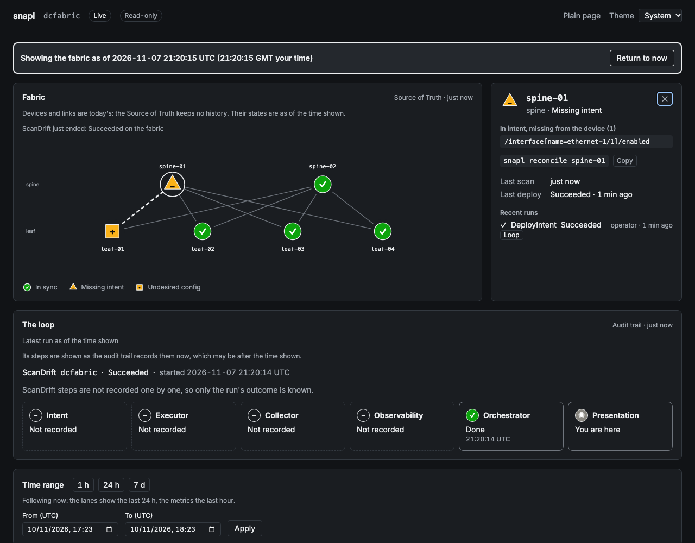

# snapl

A closed network automation loop (**intent → deploy → verify → drift → reconcile**) running against a real Nokia SR Linux fabric, built as the [Network Automation Forum (NAF)](https://networkautomation.forum/) Framework's six building blocks.

## What it does

The Source of Truth (Infrahub) holds what the network is supposed to look like. snapl renders that intent, pushes it to the devices over gNMI, reads the devices back, and compares the two.

When they disagree, that's drift. snapl reports it, and an operator can reconcile the device back to intent. Every step runs as a durable Temporal workflow and lands in an audit trail that survives restarts.

What this demonstrates, live, on a six-node spine-leaf fabric in Containerlab:

- **Deploy and verify.** `snapl deploy spine-01` renders intent, applies it, then collects the device's state and checks that the change actually took.
- **Drift detection in both directions.** `snapl scan` flags config the device is *missing* and config the device carries that intent *never asked for*: a hand-added interface address or BGP neighbour.
- **Reconcile.** `snapl reconcile` re-applies intent to drifted devices. Remediation is always operator-triggered, never automatic.
- **Durability.** Workflows survive a worker restart. `snapl audit` reads the trail by workflow or by device.

## NAF building blocks

| Block | Package | What it does here |
|-------|---------|-------------------|
| Intent | `snapl-intent` | Infrahub schema, seed data, desired-state models |
| Executor | `snapl-executor` | Jinja2 rendering + gNMI apply and dry-run |
| Collector | `snapl-collector` | gNMI GET of live device state |
| Observability | `snapl-observability` | Structural drift diff, drift events |
| Orchestrator | `snapl-orchestrator` | Temporal workflows: deploy, scan, reconcile; durable audit |
| Presentation | `snapl-presentation` | The `snapl` operator CLI |

## Scope

- **Datacenter fabric (current):** spine-leaf eBGP underlay, 2 spines and 4 leaves.
- **Site edge (next, #117):** a manufacturing site edge with an OT segmentation rule as intent.
- **Roadmap, not started:** SD-WAN, WAN backbone.

Single vendor: Nokia SR Linux. Vendor-specific code is confined to a few named places (gNMI implementations, templates, the drift field map, one collect adapter), so a second vendor has somewhere to go. snapl doesn't claim multi-vendor support until a second vendor runs the full loop.

## Known limitations

- **Removal is not implemented (#65).** Apply is a merge, so config deleted from intent stays on the device. snapl *detects* that undesired config and reports it, but does not remove it. Convergence is true for additions and changes.
- **Self-healing is opt-in, per use case.** `demo.up` creates a report-only drift schedule (every 5 minutes); scheduled repairs happen only after `snapl schedule mode remediate`. A scheduled repair never removes config (#65), and a failed repair is retried every run until an operator switches back to report (#136).
- **A local, read-only dashboard, with no authentication.** `snapl dashboard` serves on 127.0.0.1 (specs 010 to 012). Some limits of what it shows:
  - The loop strip shows steps the audit trail recorded as finished. It never shows a step in progress, and scans and reconciles record no steps one by one.
  - At a past time, the drawing shows today's devices and links, because the Source of Truth keeps no history. Only their states are from the past.
  - An archive shows its metrics only over the range they were exported for, 7 days by default.
- **Lab metrics, not monitoring.** Prometheus in the dev stack records how long workflows and gNMI calls take, gNMI errors, how long activities wait for a worker, and whether the worker and the dashboard's sources were up (spec 012). The dashboard charts them. There is no alerting, and the numbers describe a lab on one machine.
- **Config-level verification only.** Intent describes configuration. Operational expectations (BGP sessions established, interfaces oper-up) are not yet checked.

## Quick start

Needs Docker (OrbStack on macOS) and uv.

```bash
uv sync --all-groups
cp development/.env.example development/.env
uv run invoke demo.up             # stack + SR Linux fabric + seeded SoT + drift schedule + preflight
uv run invoke orchestrator.start  # the worker, in its own terminal

uv run snapl status
uv run snapl deploy spine-01
uv run snapl scan
uv run snapl schedule show        # the report-only drift schedule demo.up created
uv run snapl dashboard            # http://127.0.0.1:18030, read-only, in its own terminal
```

Metrics and the audit trail outlive `demo.reset`: they live under `.snapl/` and the reset deletes only Docker volumes. To keep them beyond the machine, or to start the metrics over:

```bash
uv run invoke history.archive     # audit DB, metrics snapshot, lab runs and a dashboard export, in one tarball
uv run invoke history.purge       # delete the stored metrics (stop the stack first), and nothing else
```

## The dashboard



`uv run snapl dashboard` serves the dashboard at http://127.0.0.1:18030. It only reads.

The page draws the fabric with each device's drift state, by shape and colour, and a lane per device shows that state over time. "As of" replays the drift scan by scan, and the loop strip shows what each NAF block did in one run. Below them are the schedule, the runs, CI, lab evidence, the hourly history and the metrics. Each view says where its data came from and how old it is, and when a source is down it gives the command that fixes it.

The page is built with Node, once, and Node is not needed to run snapl:

```bash
uv run invoke dashboard.build     # needs Node 22.12 or later
```

Without that build, `/` serves the plain page of spec 010, which is always at `/plain` as well.

Two more ways to read it:

```bash
uv run snapl dashboard --archive .snapl/archives/<file>.tar.gz   # a history.archive tarball, with nothing running
uv run snapl dashboard --snapshot demo.html --days 7              # one HTML file that opens offline, from disk
```

An archive opens with the stack stopped and contacts nothing. Ages and "now" are relative to when it was made. A snapshot is a recording: it says so, refreshes nothing, and includes error text and paths recorded from the devices as they were recorded, so read it before you share it.

[`docs/demo-scenarios.md`](docs/demo-scenarios.md) walks through the full demo: deploy, inducing drift by hand, scanning, reconciling, and reading the audit trail.

## How it is built

Two methodologies govern the code:

- **[Spec-Driven Development](https://github.com/github/spec-kit).** Every block and every new capability starts as a spec in [`specs/`](specs/).
- **Test-Driven Development**, with one rule learned the hard way: mocks encode assumptions, so changes at a system boundary also carry evidence from a live lab run.

The governing rules are in the [constitution](.specify/memory/constitution.md); the reasoning behind them is in [`dev/adr/`](dev/adr/). [AGENTS.md](AGENTS.md) is the entry point for AI coding agents.

```bash
uv run invoke lint        # ruff
uv run invoke test-unit   # unit tests, no infrastructure needed
uv run invoke test-e2e    # the demo arc end to end, against a live stack (run recorded in .snapl/test-runs/)
uv run invoke test-integration  # the integration tests, against a live stack (run recorded the same way)
```

## Lineage

snapl builds on patterns from [project-network-synapse-quattro](https://github.com/anton-tvrz/project-network-synapse-quattro).
