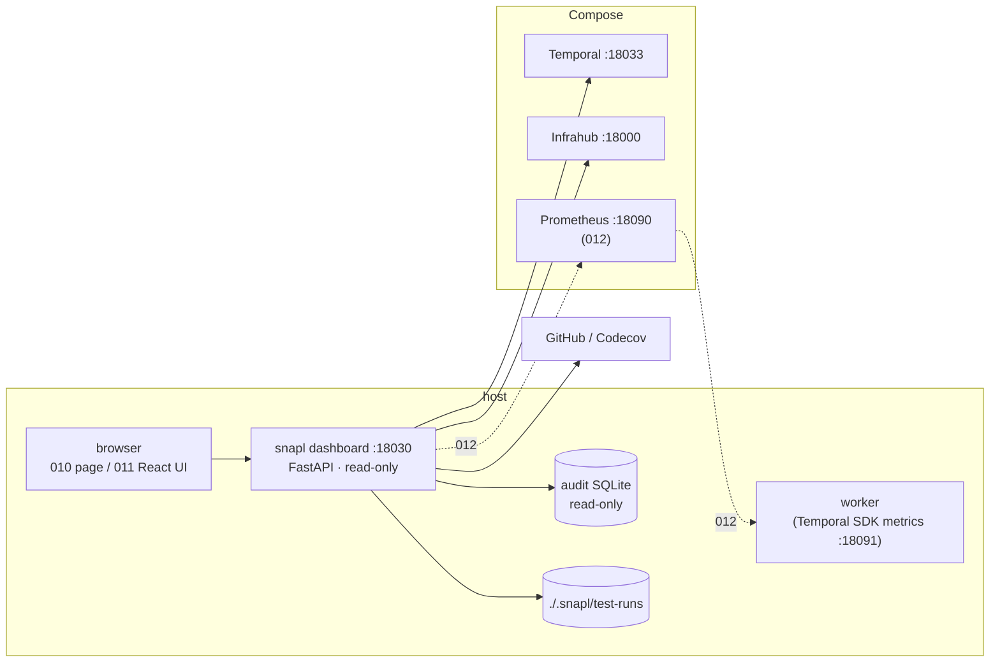

# ADR-0005: Dashboard and Metrics Stack

## Status

Proposed

## Date

2026-11-07

## Context

#101 found that drift and audit have no surface an operator can look at, and that snapl has no metrics at all. Spec 006 shipped the CLI half of #101's proposal. Spec 009 then made the loop run on its own every five minutes. The gap got worse: the loop now does work nobody watches.

#101 proposed Prometheus plus Grafana, and the port registry reserved 3000→18030 and 9090→18090 for them. A design session with the maintainer on 2026-11-07 revisited that and split the work into three specs:

- **010** — a local, read-only dashboard server with a typed JSON API and a plain page
- **011** — a designed UI on that API
- **012** — measured metrics

Each spec brings a technology the constitution's Technology Stack does not list. This ADR records all three together, because they only make sense as one design.

## Decision

### 1. FastAPI and uvicorn in `snapl-presentation` (spec 010)

The dashboard is a second Presentation surface next to the CLI, so the dependency goes in `snapl-presentation` only.
- **Why FastAPI**: the API's contract is the same Pydantic v2 models the rest of snapl uses. FastAPI validates and serialises them and generates an OpenAPI document from them. Spec 011 generates its front-end types from that document, so there is one source for the contract.
- **Bind and access**: it binds to loopback by default, has no authentication, and is read-only. Only GET routes exist, and the audit log is opened in SQLite read-only mode.

### 2. A Node build toolchain for the UI only (spec 011)

The UI uses React, Vite, TypeScript, Tailwind with shadcn/ui, Recharts and React Flow.
- **Build-time only**: Node is needed to *build* it, never to run snapl. The built files are not committed. `invoke dashboard.build` produces them, and `build-artifacts.yml` builds them before `uv build`, so the wheel ships them.
- **CI**: gets one path-filtered front-end job.
- **Bounded**: the toolchain lives in one directory and touches no Python package's dependencies.

### 3. Prometheus, without Grafana (spec 012)

Prometheus runs in the Compose stack on 18090. It scrapes:
- the worker's built-in Temporal SDK metrics on 18091 (the worker runs on the host)
- gNMI timing, measured in the orchestrator activities, so `snapl-executor` and `snapl-collector` take no metrics dependency

**Grafana is dropped.** The dashboard queries Prometheus through its own API, and Prometheus's `/graph` page covers ad-hoc queries. Port 18030 moves to the dashboard.

**Retention is by size only** (`--storage.tsdb.retention.size`, with no time limit), and the data lives in a git-ignored host directory, not a Docker volume. Two reasons:
- A time limit deletes everything on the first start after a long break from the project.
- `demo.reset` removes Docker volumes, and a reset should restart the lab, not erase what was learned from it.

### Diagram

## Consequences

### Positive
- The loop's state, history and evidence are visible in one place. Every view states its source and age (ADR-0004).
- One contract, from Pydantic through OpenAPI to TypeScript, serves the page, the UI, snapshot export and metrics.
- The block boundaries hold. Executor and collector gain no dependency, and no ABC is widened.
- Long breaks from the project lose no history.

### Negative
- `snapl-presentation` gains two runtime dependencies.
- Contributors who change the UI need Node. CI gains a front-end job.
- Prometheus adds a Compose service and a host directory that grows until its size cap.
- With no Grafana, dashboards are code, not configuration. That is a deliberate trade for a single maintainer.
- The constitution's Technology Stack does not list these. Listing them needs a minor version bump, deferred until 011 or 012 lands, so the stack never claims something not yet in the code.
